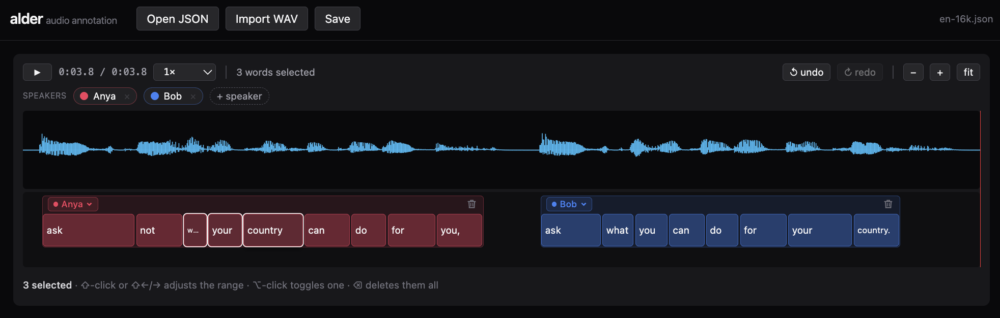

# alder

A delightful audio annotation tool for **transcription** (what was said, when) and
**diarization** (who said it). Built with TypeScript, SolidJS, Tailwind v4, and
Vite in a pnpm monorepo.

Try the single file html build on [github pages](https://nickcrews.github.io/alder/).



## Annotation Data model

```ts
interface Speaker { id: number; label: string }
interface Word    { timestamp: number; text: string }  // seconds since clip start
interface Segment { speaker_id: number; words: Word[] }
interface AnnotationState { speakers: Speaker[]; segments: Segment[] }
```

Example:

```jsonc
{
  "speakers": [{ "id": 0, "label": "Alice" }, { "id": 1, "label" "Bob"}],
  "segments": [
    { "speaker_id": 0, "words": [{ "timestamp": 0.532, "text": "Hi." }] },
    { "speaker_id": 1, "words": [{ "timestamp": 1.23, "text": "What's" }, {"timestamp": 1.33, "text": "up?"}] }
  ]
}
```

Remarks:
- We only model the start time of a word, there is no notion of end/duration.
- The start/end of a Segment is implicit, derived from the contained Words.
- Segments can be overlapping, eg if two people are speaking at the same time.
- This data model is trivial to serialize to JSON.

## Audio Data Model

I designed this to work efficiently with static hosting services,
eg drop your hours long audio file in an S3 bucket or on GitHub pages,
point the frontend at that URL, and it just works with
efficient network and frontend-memory usage.

Audio can be provided inline as a raw array of little-endian float32 mono PCM, if you source the bytes
yourself.
Or you can pass a URL. Then the client makes `Range` requests
to the server to fetch the duration/sample rate, then lazily fetches
the actual audio data on demand.

## UI

I really tried to sweat the details to make the annotation process as delightful as possible.

- **Waveform**: click to seek, drag to pan, scroll/pinch to zoom (anchored at
  cursor), red playhead follows playback. Space = play/pause. Choose playback speed.
- **Tracks**: segments are packed greedily into lanes — overlapping speech
  stacks, alternating speakers share a lane. Colors are per-speaker.
- **Words**: drag to retime (clamped between neighbors); double-click to edit
  text — a space splits the word (timestamps interpolated), Backspace at the
  start joins into the previous word, empty text deletes. Arrow key nav.
  shift+click and ctrl+click multiselection works.
- **Segments**: drag the label strip to shift the whole segment in time.
   Right-click empty track space to create a segment.
   Select multiple and then click to merge them.
   Right click to split a segment at that timestamp.
- **Speakers**: add / rename (double-click) / delete (only when unused).
- **Copy/paste**: ⌘C writes the selection as text (plus HTML with speaker labels
  when whole segments are selected). ⌘V overlays the pasted words onto the
  selected ones slot by slot, each keeping the timestamp it lands on; surplus
  words subdivide the last slot, unused slots are deleted, so nothing outside
  the selection changes. With nothing selected it creates a segment at the
  playhead, evenly spaced by the median word gap. No cut.
- **Undo/redo**: ⌘Z / ⇧⌘Z, snapshot-based.

## CLI

Annotate a directory holding a `.psv` (pipe-separated-values, see below) transcript and its `.wav` — built for
maintaining golden annotations in place:

```sh
npx @nickcrews/alder path/to/meeting_dir/
```

It picks the single `.psv` and `.wav` in the directory (or pass `--psv` /
`--audio`), serves the annotator on localhost, opens a browser, and writes
⌘S straight back to the `.psv`. `--port`, `--no-open`, and `--help` also work.

The server does nothing clever with the audio: it serves the `.wav` with
byte-range support and stops there. The browser reads the header for duration,
approximates the zoomed-out waveform by striding a few hundred small range reads
across the file, refines to exact samples as you zoom in, and streams playback
through an `<audio>` element. A 2h46m / 319 MB meeting costs a few MB in the tab
and seeks instantly — and because the server is just a static file host, the
same frontend works unchanged against an object store or GitHub Pages.

Saving is conservative, because the target is version-controlled golden data:

- Segments you didn't touch re-render byte-for-byte, so the diff shows only
  real edits.
- Writes go to a temp file and are renamed into place.
- If the `.psv` changed on disk since it was loaded, the save is refused
  rather than clobbering the other edit.
- Unknown `event_type` values are a parse error, never a silent drop.

### The `.psv` format

```
start_sec|event_type|event_data
0:00:07.81|meta|{"begin_speaker":"segmented:spk-0"}
0:00:07.81|text|Make
0:00:07.97|text|sure
```

A `meta` row carrying `begin_speaker` opens a segment; every `text` row after
it is a word in that segment. The `begin_speaker` string is the alder speaker
label, so renaming a speaker in the UI rewrites it everywhere it appears. Times
are `H:MM:SS.ss`, and round-trip at that centisecond resolution.

## Packages

- **`packages/alder`** (`@nickcrews/alder`) — the annotator as an importable
  SolidJS library, and the `alder` CLI (`cli/`).
- **`packages/alder-standalone`** (`@nickcrews/alder-standalone`) — builds a
  fully self-contained `dist/index.html` (works from `file://`): open/save
  annotation JSON, import a WAV, drag & drop, and a bundled demo clip
  (`src/assets/en-16k.wav`, the 3.85 s "Ask not what your country…" sample,
  with estimated word timings to correct).

## Using the library

As a Solid component (uncontrolled; wrap `onChange`/`ref` to make it controlled):

```tsx
import { createResource, Show } from "solid-js";
import { Annotator, parseAnnotation, urlSource } from "@nickcrews/alder";

// Source construction is async, so resolve it before rendering.
const [source] = createResource(() => urlSource("/audio.wav"));

<Show when={source()} fallback={<p>Loading audio…</p>}>
  <Annotator
    initialState={parseAnnotation(json)}   // transcript only
    audioSource={source()!}                // audio, supplied separately
    onChange={(state) => console.log("edited", state)}
    ref={(handle) => {
      // handle.getState() / handle.setState(state)
      // setState replaces speakers/segments; audio is fixed per instance (remount to change it)
    }}
  />
</Show>;
```

`audioSource` is required — audio never enters through `initialState` — and it
must be a resolved `AudioSource`, so `await` the factory (or gate on a
`createResource`, as above) before mounting. For samples already in memory use
`await bufferSource(samples, sampleRate)`, or decode WAV/raw f32 bytes with
`await bufferSourceFromBytes(bytes)`. The source is caller-owned: the annotator
never destroys one you passed in.

### Streaming from a static host

`bufferSource` holds every sample in memory, which is fine for clips but not for
a three-hour meeting (~1.3 GB once the `AudioBuffer` copy is counted).
`urlSource(url)` streams instead, and the only thing it asks of the server is
`Range` support — so it works directly against an object store, S3, a CDN, or
GitHub Pages, with no peaks endpoint and no metadata to precompute:

```ts
import { urlSource } from "@nickcrews/alder";

const source = await urlSource("https://static.example.com/meeting.wav");
// <Annotator initialState={{ speakers, segments }} audioSource={source} />
```

One small range request reads the WAV header for duration and sample rate. The
zoomed-out waveform is approximated by striding a few hundred more small reads
across the file and refined to exact samples as you zoom into a span narrow
enough to fetch whole; playback is an `<audio>` element on the same URL, so the
browser range-requests only what it plays. The promise settles once the header
is parsed — the overview streams in afterward and redraws. Small files, hosts
that ignore `Range`, and non-WAV bytes fall back to one whole-file download.

> Only WAV streams (its byte layout maps directly to sample offsets). For a
> compressed source, transcode to WAV or hand decoded samples to
> `bufferSource`.

Framework-free (this is the surface a future anywidget bridge builds on —
styles are injected automatically, ESM, no module-scope DOM access):

```ts
import { mountAnnotator } from "@nickcrews/alder";

const widget = mountAnnotator(el, { initialState, audioSource, onChange });
// widget.getState(), widget.setState(s), widget.destroy()
```

Sketch of the eventual anywidget `render`:

```js
export default {
  async render({ model, el }) {
    const widget = mountAnnotator(el, {
      initialState: parseAnnotation(model.get("annotation")),
      audioSource: await bufferSourceFromBytes(model.get("audio")), // sidecar bytes
      onChange: (s) => {
        model.set("annotation", serializeAnnotation(s));
        model.save_changes();
      },
    });
    return () => widget.destroy();
  },
};
```

## Quick start

```sh
pnpm install
pnpm dev        # standalone app at http://localhost:5173
pnpm test       # vitest (serde, store ops, lanes, psv/wav round-trips, mount smoke test)
pnpm typecheck
pnpm build      # library ESM + single-file dist/index.html + the CLI bundle

# the CLI, straight from the build output
node packages/alder/dist/cli/alder.js path/to/meeting_dir/
```